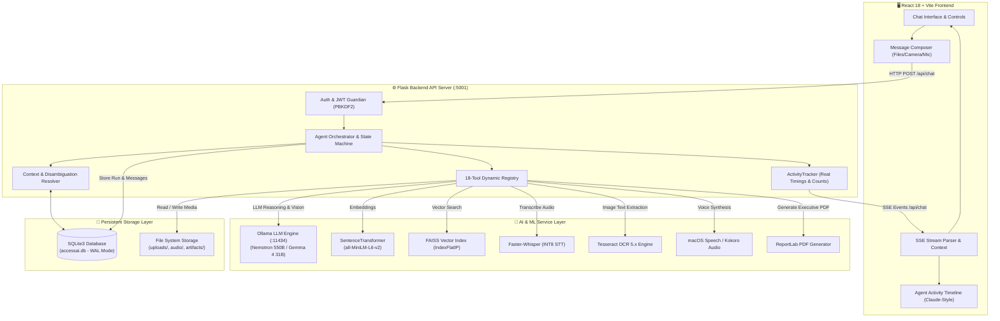
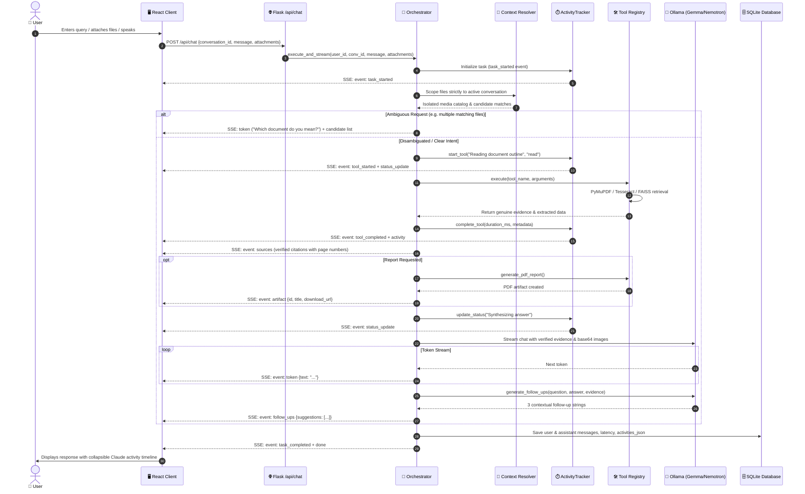
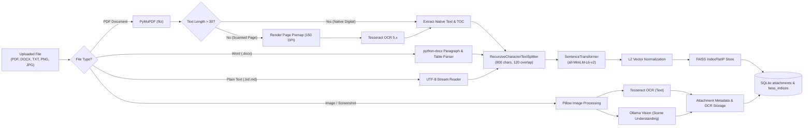
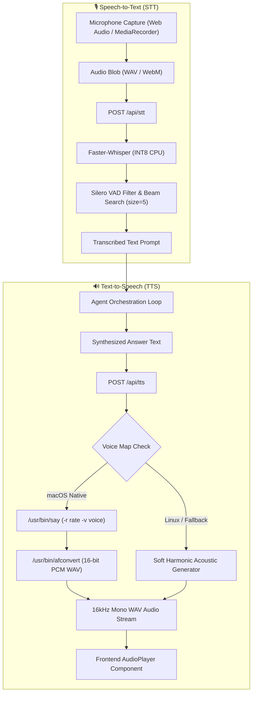
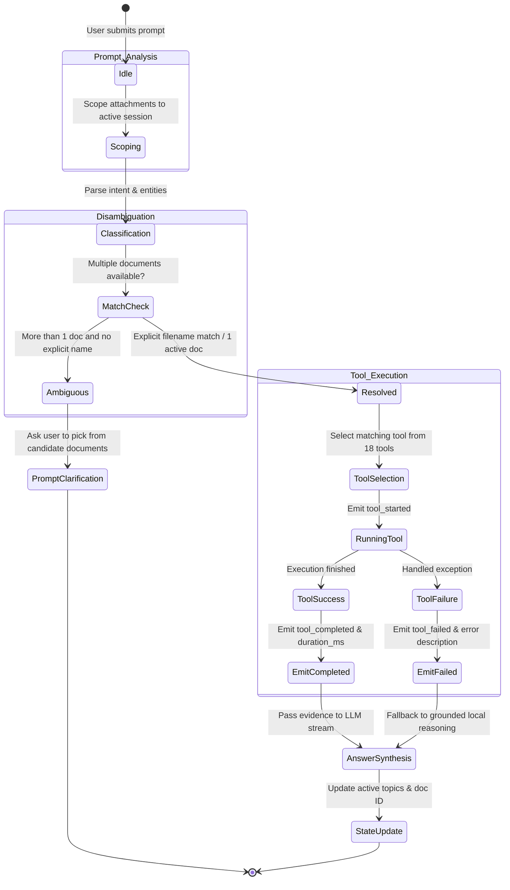

# 🌐 AccessAI — Multimodal Accessibility Agent & Claude-Style Activity Timeline

AccessAI is a state-of-the-art, context-aware, multimodal accessibility AI application designed for document intelligence, image scene understanding, and speech synthesis. It features an agentic interaction pattern inspired by Claude's interface—featuring a real-time, non-fabricated coding-agent activity timeline driven 100% by backend tool execution events over Server-Sent Events (SSE).

---

## 📑 Table of Contents

- [Key Features](#-key-features)
- [Complete Technology Stack & Libraries](#-complete-technology-stack--libraries)
- [AI Models & Engines](#-ai-models--engines)
- [System Architecture & Workflow Diagrams](#-system-architecture--workflow-diagrams)
  - [1. High-Level System Architecture](#1-high-level-system-architecture)
  - [2. Agent Orchestration & Real-Time SSE Stream Loop](#2-agent-orchestration--real-time-sse-stream-loop)
  - [3. Multimodal Document & Image Ingestion Pipeline](#3-multimodal-document--image-ingestion-pipeline)
  - [4. Voice Processing & Synthesis Pipeline](#4-voice-processing--synthesis-pipeline)
  - [5. Context Resolution & State Disambiguation Machine](#5-context-resolution--state-disambiguation-machine)
- [Agent Tool Registry (18 Specialized Tools)](#-agent-tool-registry-18-specialized-tools)
- [Database Schema & Persistence](#-database-schema--persistence)
- [API Contract & SSE Protocol](#-api-contract--sse-protocol)
- [Environment Configuration](#-environment-configuration)
- [Installation & Getting Started](#-installation--getting-started)
- [Testing & Quality Assurance](#-testing--quality-assurance)

---

## 🌟 Key Features

### 1. Claude-Style Conversation Experience
- **Minimal Dark Interface:** Designed with a curated dark theme palette, glassmorphism cards, and high-contrast orange accents (`#ea580c`).
- **Live Task Status Indicator:** Displays dynamic, muted task-status pulses directly above agent responses (e.g., `Reading document outline...`, `Running OCR on diagram...`, `Synthesizing answer...`).
- **Expandable Real-Time Activity Timeline:** Claude-style collapsible activity timeline with live duration pills, status badges, file tags, and zero fabricated operations.
- **Progressive SSE Token Streaming:** Token-by-token response streaming rendered with `requestAnimationFrame` batching, syntax-highlighted code blocks, tables, and embedded media.
- **Contextual Follow-Up Suggestions:** Synthesizes 3 intelligent, domain-specific follow-up inquiries based on extracted headings, backticked code tokens, and conversational intent.
- **Executive PDF Report Artifacts:** Compiles professional multi-page executive summary PDF reports via ReportLab with instant preview and download capabilities.
- **Mac-Style 3-Finger / Cmd-Click Lookup:** Integrated dictionary and knowledge lookup popover for any word or phrase on the screen.

### 2. Multi-Turn Context Resolution & Disambiguation
- **Conversation Media Isolation:** Uploaded documents, images, and audio attachments are strictly isolated per conversation session to prevent cross-chat data leaks.
- **Natural Language Disambiguation:** Resolves generic queries (e.g., *"What is in the PDF?"*, *"Explain the diagram on page 7"*, *"Summarize the second topic"*, *"Continue"*) by inspecting active document outlines, recent assistant turns, and candidate lists.
- **Clarification Triggering:** Prompts the user with structured candidate selections when multiple ambiguous documents match a query.

### 3. Comprehensive Accessibility Suite
- **Speech-to-Text (STT):** Local, high-precision voice transcription using Faster-Whisper with auto-language detection and voice activity detection (VAD).
- **Text-to-Speech (TTS):** Low-latency 16-bit PCM WAV audio synthesis with adjustable speech rates and multiple natural voice profiles.
- **Accessible Summaries & Tables:** Generates structured, screen-reader optimized summaries, table markdown extractions, and reading-order preserved OCR transcriptions.

---

## 🛠️ Complete Technology Stack & Libraries

### Frontend Architecture
| Layer / Library | Version | Purpose & Technical Role |
| :--- | :--- | :--- |
| **React** | `18.3.1` | Core UI library utilizing functional components, custom hooks, and Context API. |
| **Vite** | `8.3.4` | High-performance build tool, ESM development server, and reverse proxy for backend APIs. |
| **React Router DOM** | `7.18.4` | Client-side routing for `/chat`, `/login`, `/settings`, and `/metrics`. |
| **Lucide React** | `^0.460.0` | Accessible, unified SVG icon set for UI actions, controls, and tool status. |
| **React Markdown & Remark GFM**| `9.0.1` / `4.0.1` | Full GitHub Flavored Markdown renderer with tables, task lists, and strikethroughs. |
| **PrismJS** | `1.30.0` | Syntax highlighting for code blocks in Python, JavaScript, JSON, Shell, and C++. |
| **Fontsource Variable Fonts** | `^5.1.0` | Zero-layout-shift typography: *Inter* (UI), *Bricolage Grotesque* (Headings), *JetBrains Mono* (Code/Badges). |
| **HTML5 MediaRecorder & Web Audio** | Native | Captures user microphone audio as WebM/WAV blobs for transcription. |
| **Vitest & Testing Library** | `5.0.5` / `16.3.3` | Unit, component, and DOM interaction testing with JSDOM environment. |

### Backend Architecture
| Layer / Library | Version | Purpose & Technical Role |
| :--- | :--- | :--- |
| **Python** | `3.10+` | Core backend programming language. |
| **Flask & Flask-CORS** | `3.1.0` / `5.0.1` | Lightweight REST API and Server-Sent Events (SSE) streaming server. |
| **Werkzeug** | `3.1.x` | Secure filename handling, request routing, and HTTP utilities. |
| **SQLite3 (WAL Mode)** | Native | Transactional database with Write-Ahead Logging (`PRAGMA journal_mode = WAL`) and foreign key constraints. |
| **python-dotenv** | `^1.0.0` | Automatic environment variable loading from root and backend `.env` files. |
| **PyMuPDF (`fitz`)** | `1.25.0` | Ultra-fast PDF parsing, native table-of-contents extraction, text extraction, and page rendering (150 DPI) for OCR. |
| **python-docx** | `1.1.2` | Extracts structured text, paragraphs, and tables from `.docx` documents. |
| **Pillow (`PIL`)** | `11.0.0` | Image processing, resizing, format conversion, and pixel analysis. |
| **pytesseract** | `0.3.13` | Python binding for Tesseract OCR 5.x engine with layout analysis. |
| **ReportLab** | `^4.0.0` | Programmatic executive PDF document generation (`SimpleDocTemplate`, `ParagraphStyle`, `HRFlowable`). |
| **FAISS (`faiss-cpu`)** | `1.15.0` | Fast vector similarity search with `IndexFlatIP` (inner product / cosine similarity on normalized vectors). |
| **sentence-transformers** | `3.0.0` | Neural embeddings generation using dense transformer models. |
| **langchain-text-splitters**| `0.3.0` | Recursive character chunking preserving sentence boundaries and paragraphs. |
| **faster-whisper** | `1.2.0` | CTranslate2-based implementation of OpenAI's Whisper model (INT8 quantized inference). |
| **PyAudio / macOS Say** | Native / CLI | Audio playback, conversion (`afconvert`), and text-to-speech synthesis. |
| **pytest & pytest-flask** | `8.0.0` / `1.3.0` | 64 automated tests covering activity timelines, agent scenarios, auth, and streaming. |

---

## 🤖 AI Models & Engines

### 1. Large Language & Multimodal Models (via Ollama)
- **`nemotron-3-ultra:cloud`** (NVIDIA 550B Architecture): Default conversational and reasoning engine for complex synthesis, document comparison, and multi-turn planning.
- **`gemma4:31b-cloud`** (Google 31B Multimodal): High-capacity vision-language model capable of analyzing raw images, CAD schematics, and diagrams passed directly as base64 payloads.
- **`gpt-oss:20b-cloud` & `gpt-oss:120b-cloud`**: High-throughput open-architecture models for fast conversational chat and code understanding.
- **Vision Model Fallbacks:** Compatible with `llama3.2-vision`, `llava`, `bakllava`, and `moondream`.

### 2. Semantic Embedding Model
- **`sentence-transformers/all-MiniLM-L6-v2`**:
  - Embedding dimensions: **384**
  - Sequence length: **256 tokens**
  - Search metric: Cosine similarity via `IndexFlatIP`
  - Fallback engine: Normalized n-gram bag-of-words vector projection when offline.

### 3. Speech Recognition (STT) Models
- **`faster-whisper` (`base`, `tiny`, `small`)**:
  - Quantization: **INT8** CPU inference
  - Audio sampling: 16 kHz mono PCM
  - Beam size: **5** with integrated Voice Activity Detection (`vad_filter=True`)
  - Supported languages: 10+ languages with automatic language detection (`auto`).

### 4. Speech Synthesis (TTS) Profiles
- High-fidelity 16-bit 16kHz PCM WAV output with adjustable speech speed (80–360 wpm):
  - `af_heart` — Natural US Female (Samantha)
  - `af_bella` — Warm US Female (Victoria)
  - `am_michael` — Articulate US Male (Alex)
  - `bf_emma` — Professional UK Female (Serena)
  - `bm_george` — Deep UK Male (Daniel)

---

## 📐 System Architecture & Workflow Diagrams

### 1. High-Level System Architecture



---

### 2. Agent Orchestration & Real-Time SSE Stream Loop



---

### 3. Multimodal Document & Image Ingestion Pipeline



---

### 4. Voice Processing & Synthesis Pipeline



---

### 5. Context Resolution & State Disambiguation Machine



---

## 🛠️ Agent Tool Registry (18 Specialized Tools)

The backend exposes an extensible `ToolRegistry` with 18 specialized accessibility, analysis, and multimodal tools:

| # | Tool Identifier | Parameters | Description |
| :---: | :--- | :--- | :--- |
| **1** | `list_conversation_files` | `conversation_id` | Lists all documents and images uploaded in the conversation or user library. |
| **2** | `list_available_images` | `conversation_id` | Catalogs all image attachments with AI scene descriptions and OCR text. |
| **3** | `get_file_metadata` | `file_id` | Retrieves page counts, character length, OCR usage status, and file size. |
| **4** | `extract_document_text` | `file_id` | Extracts the raw textual content across all pages in a document. |
| **5** | `get_document_outline` | `file_id` | Extracts native table of contents or prominent page heading blocks. |
| **6** | `search_document` | `file_id`, `query` | Performs high-precision keyword and semantic regex searches across all pages. |
| **7** | `get_page_content` | `file_id`, `page_number` | Retrieves the exact text, OCR content, and metadata for a specific 1-indexed page. |
| **8** | `get_document_images` | `file_id`, `page_number?` | Extracts and catalogs raster images embedded within document pages. |
| **9** | `describe_image` | `file_id` | Generates a comprehensive visual scene description combined with OCR text. |
| **10** | `answer_question_about_image` | `file_id`, `question` | Answers visual questions about objects, colors, layout, and visible text. |
| **11** | `extract_table` | `file_id`, `page_number?` | Parses structured table cells into clean, screen-reader-friendly Markdown tables. |
| **12** | `analyze_chart` | `file_id`, `page_number?` | Analyzes engineering schematics, charts, flow diagrams, and mechanical figures. |
| **13** | `compare_documents` | `file_id_1`, `file_id_2` | Compares thematic scope, headings, mechanical concepts, and document differences. |
| **14** | `generate_accessible_summary`| `file_id` | Creates an accessible, structured, screen-reader-optimized document overview. |
| **15** | `generate_pdf_report` | `file_id`, `focus_topic?`| Compiles an executive summary PDF using ReportLab and delivers it as an artifact. |
| **16** | `extract_image_text` | `file_id` | Extracts text from an image or screenshot preserving top-to-bottom reading order. |
| **17** | `text_to_speech` | `text`, `voice?`, `speed?`| Synthesizes text into high-fidelity 16-bit PCM WAV audio. |
| **18** | `speech_to_text` | `audio_id`, `language?` | Transcribes spoken audio recordings into text using Faster-Whisper. |

---

## 🗄️ Database Schema & Persistence

AccessAI uses SQLite with Write-Ahead Logging (`WAL` mode) for concurrent read-write performance and durability:

```sql
-- 1. Users & Credentials
CREATE TABLE users (
    id TEXT PRIMARY KEY,
    name TEXT NOT NULL,
    email TEXT UNIQUE NOT NULL,
    password_hash TEXT NOT NULL,
    created_at TIMESTAMP DEFAULT CURRENT_TIMESTAMP
);

-- 2. User Model & Accessibility Settings
CREATE TABLE settings (
    user_id TEXT PRIMARY KEY,
    settings_json TEXT NOT NULL,
    updated_at TIMESTAMP DEFAULT CURRENT_TIMESTAMP,
    FOREIGN KEY(user_id) REFERENCES users(id) ON DELETE CASCADE
);

-- 3. Conversation Sessions
CREATE TABLE conversations (
    id TEXT PRIMARY KEY,
    user_id TEXT NOT NULL,
    title TEXT NOT NULL,
    created_at TIMESTAMP DEFAULT CURRENT_TIMESTAMP,
    updated_at TIMESTAMP DEFAULT CURRENT_TIMESTAMP,
    FOREIGN KEY(user_id) REFERENCES users(id) ON DELETE CASCADE
);

-- 4. Messages with Full Activity History
CREATE TABLE messages (
    id TEXT PRIMARY KEY,
    conversation_id TEXT NOT NULL,
    role TEXT NOT NULL,
    content TEXT NOT NULL,
    attachments_json TEXT,
    sources_json TEXT,
    artifact_json TEXT,
    activities_json TEXT,       -- Genuine executed activity steps for timeline reload
    follow_ups_json TEXT,       -- 3 contextual follow-up suggestions
    latency_ms REAL,
    model TEXT,
    created_at TIMESTAMP DEFAULT CURRENT_TIMESTAMP,
    FOREIGN KEY(conversation_id) REFERENCES conversations(id) ON DELETE CASCADE
);

-- 5. Attachments (Scoped Media)
CREATE TABLE attachments (
    id TEXT PRIMARY KEY,
    user_id TEXT NOT NULL,
    conversation_id TEXT,       -- Session-bound isolation
    name TEXT NOT NULL,
    kind TEXT NOT NULL,         -- 'document' | 'image' | 'audio'
    file_path TEXT NOT NULL,
    pages INTEGER DEFAULT 1,
    chars INTEGER DEFAULT 0,
    ocr_used INTEGER DEFAULT 0,
    extracted_text TEXT,
    image_description TEXT,
    created_at TIMESTAMP DEFAULT CURRENT_TIMESTAMP,
    FOREIGN KEY(user_id) REFERENCES users(id) ON DELETE CASCADE,
    FOREIGN KEY(conversation_id) REFERENCES conversations(id) ON DELETE SET NULL
);

-- 6. Generated Artifacts (Downloadable Reports)
CREATE TABLE artifacts (
    id TEXT PRIMARY KEY,
    user_id TEXT NOT NULL,
    conversation_id TEXT,
    title TEXT NOT NULL,
    kind TEXT NOT NULL,
    file_path TEXT NOT NULL,
    file_size INTEGER DEFAULT 0,
    pages INTEGER DEFAULT 1,
    summary_text TEXT,
    created_at TIMESTAMP DEFAULT CURRENT_TIMESTAMP,
    FOREIGN KEY(user_id) REFERENCES users(id) ON DELETE CASCADE,
    FOREIGN KEY(conversation_id) REFERENCES conversations(id) ON DELETE SET NULL
);

-- 7. Benchmark Runs & Evaluation Metrics
CREATE TABLE metrics_runs (
    id TEXT PRIMARY KEY,
    user_id TEXT,
    suite TEXT NOT NULL,
    model TEXT NOT NULL,
    samples INTEGER NOT NULL,
    score REAL NOT NULL,
    duration_s REAL NOT NULL,
    details_json TEXT,
    created_at TIMESTAMP DEFAULT CURRENT_TIMESTAMP
);
```

---

## 📡 API Contract & SSE Protocol

### Authentication
All routes under `/api` require a Bearer token header except register and login:
```
Authorization: Bearer <token>
```

### Endpoints Table
| Method | Endpoint | Description | Request Payload | Response Schema |
| :--- | :--- | :--- | :--- | :--- |
| `POST` | `/api/auth/register` | Register new account | `{name, email, password}` | `{token, user}` |
| `POST` | `/api/auth/login` | Authenticate user | `{email, password}` | `{token, user}` |
| `GET/PUT`| `/api/auth/me` | Current user profile | `PUT: {name?, email?, password?}` | `{id, name, email}` |
| `GET/PUT`| `/api/settings` | User model & speech config | `PUT: {model, temperature, ...}`| Settings Object |
| `GET` | `/api/conversations` | List user sessions | None | `[{id, title, updated_at}]` |
| `GET` | `/api/conversations/:id/messages` | Load message history | None | `[{id, role, content, activities_json, ...}]` |
| `PUT/DEL`| `/api/conversations/:id` | Rename / delete session | `PUT: {title}` | `{success: true}` |
| `POST` | `/api/documents` | Upload PDF/DOCX file | `multipart/form-data: file, conversation_id` | `{id, name, pages, chars, ocr_used}` |
| `POST` | `/api/images` | Upload image file | `multipart/form-data: file, conversation_id` | `{id, name, image_description}` |
| `POST` | `/api/stt` | Transcribe speech audio | `multipart/form-data: file, language, model` | `{text: "Transcribed text"}` |
| `POST` | `/api/tts` | Synthesize voice audio | `{text, voice, speed}` | `audio/wav` byte stream |
| `GET` | `/api/artifacts/:id/download` | Download generated report| None | Binary PDF stream |
| `POST` | `/api/chat` | Main agent streaming turn | `{message, conversation_id, attachments}` | `text/event-stream` (SSE) |
| `GET` | `/api/metrics` | Evaluation dashboard data| None | Summary, latency, robustness, runs |
| `POST` | `/api/metrics/run` | Execute benchmark suite | `{suite: "all"\|"stt"\|"ocr"\|"qa"}` | New evaluation run result |

### SSE Event Stream Protocol (`POST /api/chat`)
```
event: task_started
data: {"task_id": "task_a1b2", "conversation_id": "conv_123"}

event: status_update
data: {"status": "running", "message": "Reading document outline..."}

event: tool_started
data: {"id": "act_01", "label": "Reading document outline", "type": "read"}

event: tool_completed
data: {"id": "act_01", "status": "completed", "duration_ms": 42, "detail": "Extracted 18 pages"}

event: sources
data: [{"source": "Engineering.pdf", "page": 4, "text": "...", "score": 0.94}]

event: artifact
data: {"id": "art_99", "title": "Summary_Engineering.pdf", "download_url": "/api/artifacts/art_99/download"}

event: token
data: {"text": "Here"}

event: token
data: {"text": " is the analysis"}

event: follow_ups
data: {"suggestions": ["What are the welding parameters?", "How does solar net metering work?"]}

event: task_completed
data: {"task_id": "task_a1b2", "activity_summary": "Read 18 pages, compiled PDF report"}

event: done
data: {"latency_ms": 1420.5, "model": "nemotron-3-ultra:cloud"}
```

---

## ⚙️ Environment Configuration

### Backend Environment Configuration (`backend/.env.example`)
```env
# Server Network Settings
PORT=5001
HOST=0.0.0.0
FLASK_DEBUG=True

# Authentication Secrets
SECRET_KEY=accessai-super-secret-key-2026-prod
JWT_SECRET=accessai_super_secret_jwt_key_2026
JWT_ALGORITHM=HS256
JWT_EXPIRATION_HOURS=168

# Database Path
DATABASE_PATH=data/accessai.db

# Ollama LLM Service
OLLAMA_BASE_URL=http://localhost:11434

# Optional Storage Overrides
# UPLOADS_DIR=data/uploads
# AUDIO_DIR=data/audio
# FAISS_DIR=data/faiss_indices
# ARTIFACTS_DIR=data/artifacts
```

### Frontend Environment Configuration (`frontend/.env.example`)
```env
# API Base URL (Leave empty to use Vite reverse proxy /api -> http://localhost:5001)
VITE_API_URL=

# Vite Dev Server Proxy Target
BACKEND_URL=http://localhost:5001
```

---

## 🚀 Installation & Getting Started

### 1. Prerequisites
- **Python 3.10+**
- **Node.js 18+ & npm**
- **Tesseract OCR:**
  - macOS: `brew install tesseract`
  - Linux: `sudo apt-get install tesseract-ocr`
- **Ollama (Optional for local LLMs):** `http://localhost:11434`

### 2. Backend Setup
```bash
# Navigate to backend directory
cd backend

# Create and activate virtual environment
python3 -m venv venv
source venv/bin/activate

# Install dependencies
pip install -r requirements.txt

# Copy environment template
cp .env.example .env

# Run backend server
python3 main.py
```
> Backend runs at **`http://localhost:5001`**.

### 3. Frontend Setup
```bash
# Navigate to frontend directory in a new terminal
cd frontend

# Install Node modules
npm install

# Copy environment template
cp .env.example .env

# Start Vite development server
npm run dev
```
> Frontend runs at **`http://localhost:5173`**.

---

## 🧪 Testing & Quality Assurance

### 1. Backend Automated Test Suite (64 Comprehensive Tests)
The backend test suite covers the complete agent lifecycle, ActivityTracker, scenario benchmarks, and SSE streaming:
```bash
# Run pytest from project root or inside backend
python3 -m pytest backend/tests -v
```

**Key Test Modules:**
- `test_activity_timeline.py`: Verifies ActivityTracker start/complete/fail states, Claude summary string construction, SSE emission, and SQLite `activities_json` persistence.
- `test_scenarios_benchmark.py`: Evaluates 20 multimodal benchmark scenarios (PDF summarization, topic explanations, contextual follow-ups, diagram analysis, OCR extraction, document comparison, task continuation, STT/TTS voice roundtrips, PDF report generation, and error containment).
- `test_agent_orchestrator.py`: Multi-turn state management, context disambiguation, and tool execution.
- `test_chat_sse.py`: Server-Sent Events parser, header validation, and token chunk delivery.
- `test_auth.py`, `test_conversations.py`, `test_documents.py`, `test_images.py`, `test_media.py`, `test_metrics.py`, `test_settings.py`.

### 2. Frontend Test Suite (Vitest)
```bash
cd frontend
npm test -- --run
```
Verifies authentication flows, streaming message parsers, activity timeline state rendering, settings controls, and Mac-style lookup popovers.
